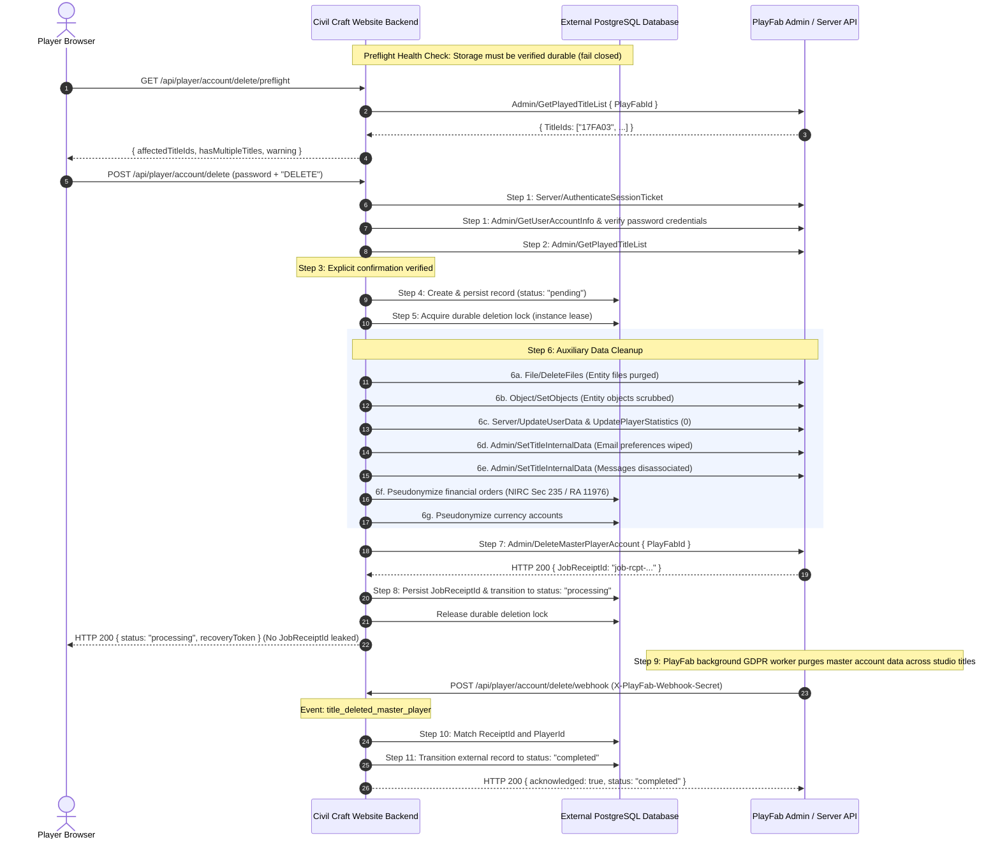

# CivilCraft Account Deletion & Data Dependency Security Audit

**Document Version:** 2.1.0  
**Target Environment:** CivilCraft Production Architecture (PlayFab Title `17FA03` + PostgreSQL Database + Unity Client + Vercel Serverless)  
**Audience:** Backend Engineers, Security Auditors, Compliance Reviewers, Operations Team

---

## 1. Executive Summary

This document details the multi-system data dependency security audit and authoritative implementation for player account deletion in CivilCraft.

Account deletion coordinates account credentials, encrypted game saves, level progression, real-time leaderboards, virtual currency ledgers, and durable deletion tracking across independent systems:
- Microsoft PlayFab Master Player Accounts & Entity storage.
- External durable PostgreSQL database (`civilcraft_website_account_deletions`).
- Financial ledgers under Philippine National Internal Revenue Code (NIRC) Section 235 as amended by Republic Act No. 11976 (Ease of Paying Taxes / EOPT Act).
- Unity game client local data wipe on session revocation.

---

## 2. Multi-System Architecture Matrix

```
+-----------------------------------------------------------------------------------+
|                            1. PlayFab Master Account                              |
|   (Credentials, Login Email, Username, Linked Devices, Contact Email, Passwords)  |
+-----------------------------------------------------------------------------------+
                                         |
         +-------------------------------+-------------------------------+
         |                               |                               |
+-------------------+           +-------------------+           +-------------------+
|  2. Entity Files  |           | 3. Title UserData |           |  4. PostgreSQL    |
| playerSaveData    |           | Levels, XP, Keys  |           | Currency Accounts |
| characterPortrait |           | Statistics/Leader |           | Purchase Receipts |
+-------------------+           +-------------------+           +-------------------+
         |                               |                               |
+-------------------+           +-------------------+           +-------------------+
|  5. Unity Client  |           | 6. Durable Storage|           | 7. Client Session |
| persistentDataPath|           | PostgreSQL Record |           | Revoked Ticket    |
| PlayerPrefs       |           | Lock & Webhooks   |           | Cleared Storage   |
+-------------------+           +-------------------+           +-------------------+
```

### Layer 1: Authentication & Credentials (PlayFab Master Account)
- **Data Covered:** Master Player Account ID, username, login email, password hash, device IDs, contact email addresses.
- **API Invocation:** `Admin/DeleteMasterPlayerAccount`.
- **Asynchronous Reality:** PlayFab queues master player account deletion and returns an immediate `{ JobReceiptId: string }`. The master account is stripped of credentials, but asynchronous background purging across studio titles takes time.
- **Authoritative Signal:** Completion is confirmed strictly when PlayFab fires the documented PlayStream GDPR event `title_deleted_master_player` matching `ReceiptId` and `PlayerId`.

### Layer 2: Game Saves & Customization (PlayFab Title Entity Files)
- **Data Covered:** `playerSaveData.json` (encrypted level progress, bridge geometry) and `characterPortrait.png` (avatar).
- **Enforcement:** Purged prior to master deletion via `File/DeleteFiles` using an administrative Title Entity Token.

### Layer 3: Player Progression & Almanac (PlayFab Title UserData & Statistics)
- **Data Covered:** `UserData` keys (`CurrentLevel`, `XP`, `MapProgress`, `PolicyAgreement`, etc.) and `Statistics` (`TotalScore`, `BridgesCompleted`, `ChallengesCompleted`, `BestSingleBuildScore`).
- **Enforcement:** UserData keys removed via `Server/UpdateUserData`; statistics reset to 0 via `Server/UpdatePlayerStatistics`.

### Layer 4: Virtual Currency & Purchases (PostgreSQL Database)
- **Data Covered:** In-game currency accounts (`civilcraft_currency.accounts`) and purchase receipts (`civilcraft_currency.receipts`).
- **Database Trigger Constraints:** The PostgreSQL currency database enforces immutable audit triggers (`permanent_account` on `civilcraft_currency.accounts` and `permanent_receipt` on `civilcraft_currency.receipts`) that strictly reject SQL `DELETE` operations on currency accounts and purchase receipts.
- **Statutory Retention Basis:** Under Section 235 of the Philippine National Internal Revenue Code (NIRC), as amended by Republic Act (RA) No. 11976 (Ease of Paying Taxes / EOPT Act), commercial sales invoices and accounting records must be preserved for **five (5) years** from the return filing deadline. Furthermore, PayMongo merchant guidelines require preserving payment references for dispute defense and chargeback resolution under Bangko Sentral ng Pilipinas (BSP) banking regulations.
- **Pseudonymization & Minimization:** Personal identifiers are replaced with deterministic hashes (`PSEUDO_PLAYER_<hash>`), and receipt claim emails are wiped (`DELETED`). Financial figures, transaction amounts, timestamps, and package references are retained for tax audits.
- **Legal Disclaimer:** This technical data minimization implementation satisfies statutory accounting duties and does not constitute formal legal certification.

### Layer 5: Local Device Storage (Unity Android Client)
- **Data Covered:** Local encrypted `playerSaveData.json` in `Application.persistentDataPath` and cached tokens in `PlayerPrefs`.
- **Technical Reality:** Offline device data cannot be remotely deleted while the player's device is disconnected from the network.
- **Enforcement:** When the device next connects to the network and launches Civil Craft, PlayFab authentication fails (`401 Unauthorized` / `AccountNotFound`), triggering the game's auth failure handler to purge local `PlayerPrefs` and save data.

### Layer 6: Durable Website Storage (PostgreSQL & Fail-Closed Protection)
- **Data Covered:** Authoritative deletion lifecycle records (`civilcraft_website_account_deletions`), distributed locks, and completion timestamps.
- **Production Requirement:** In production (Vercel serverless environment), local JSON files (`.data/account-deletions.json`) or in-memory stores are ephemeral and not shared across serverless instances. Production REQUIRES a verified PostgreSQL database (`CURRENCY_DATABASE_URL`).
- **Fail-Closed Protection:** If PostgreSQL is unreachable or unconfigured in production, deletion is rejected immediately with HTTP 503 before any destructive API call or data modification can occur.

### Layer 7: Active Browser Sessions & Cache
- **Enforcement:** Sessions are invalidated immediately upon deletion acceptance (`logout("player")`).
- **Secure Status Tracking:** Players receive a cryptographically signed HMAC recovery token (`createDeletionRecoveryToken`). This allows querying `/api/player/account/delete/status?token=<recoveryToken>` even after the session ticket has expired, without exposing `jobReceiptId`, player emails, or usernames.

---

## 3. Strict 11-Step Deletion Execution Sequence



---

## 4. Crash Recovery Procedures

### Scenario A: Server Crash After Step 4 (`pending` record created)
- The external record is persisted as `status: "pending"`.
- Upon retry, the server acquires the lock and verifies the PlayFab account status via `Admin/GetUserAccountInfo`.
- Because the master account is still intact, the server resumes auxiliary cleanup and safely proceeds to Step 7.

### Scenario B: Server Crash After Step 7 (PlayFab accepted deletion, but server crashed before Step 8 receipt persistence)
- The external record remains in `status: "pending"` with `stepsCompleted` containing `playfab_account_deletion_called`.
- If player or retry process calls `requestAccountDeletion`:
  - The server queries `Admin/GetUserAccountInfo`.
  - PlayFab returns `404 AccountNotFound` / "User not found".
  - **Safe Recovery:** The server detects the master account is already queued/erased. It **does NOT call `Admin/DeleteMasterPlayerAccount` again**.
  - It safely transitions the record to `status: "processing"` with recovery note: `PlayFab master player account already queued or erased. Awaiting PlayStream webhook.`
- When the PlayFab `title_deleted_master_player` webhook arrives:
  - If lookup by `ReceiptId` finds no record (because the crash happened before `jobReceiptId` was saved), the webhook handler falls back to matching by `PlayerId`.
  - The webhook associates the authenticated `ReceiptId`, transitions the record to `status: "completed"`, and marks `completedAt`.

---

## 5. PlayFab & Production Deployment Checklist

> [!IMPORTANT]
> The PlayStream webhook must be registered in the Microsoft PlayFab Game Manager by an authorized title administrator. Do not assume the webhook is live until these steps are completed.

### Checklist Steps:

1. **PostgreSQL Database Storage Initialization**
   - Ensure `CURRENCY_DATABASE_URL` is set in the production environment variables (e.g., Vercel Project Settings).
   - Verify connectivity to the PostgreSQL cluster.
   - The table `civilcraft_website_account_deletions` is automatically initialized with the required schema:
     - `playfab_id` (VARCHAR 64 PRIMARY KEY)
     - `status` (VARCHAR 32 NOT NULL)
     - `requested_at` (TIMESTAMPTZ NOT NULL)
     - `job_receipt_id` (VARCHAR 128, INDEXED)
     - `locked_at` (TIMESTAMPTZ), `locked_by` (VARCHAR 128)
     - `steps_completed` (JSONB), `affected_title_ids` (JSONB)
     - `pseudonymized_identifier` (VARCHAR 64)
     - `recovery_note` (TEXT), `updated_at` (TIMESTAMPTZ)

2. **Generate Secure Webhook Secret**
   - Generate a cryptographically strong 32-byte hexadecimal secret:
     ```bash
     node -e "console.log(require('crypto').randomBytes(32).toString('hex'))"
     ```
   - In Vercel Project Settings, add `PLAYFAB_WEBHOOK_SECRET` with this generated value.

3. **Configure PlayFab Game Manager PlayStream Rule / Webhook**
   - Log into [PlayFab Game Manager](https://developer.playfab.com).
   - Select Title: **Civil Craft** (Title ID: `17FA03`).
   - Navigate to: **Automation** > **Rules** (or **Webhooks**).
   - Click **New Rule** / **New Webhook**.
   - **Rule Name:** `Account Deletion Completion Webhook`
   - **Event Namespace:** `com.playfab`
   - **Event Name:** `title_deleted_master_player`
   - **Action Type:** `Send Webhook` (or `Call Webhook`)
   - **Endpoint URL:** `https://<your-production-domain>/api/player/account/delete/webhook`
   - **HTTP Headers:**
     - Header Name: `X-PlayFab-Webhook-Secret`
     - Header Value: `<PLAYFAB_WEBHOOK_SECRET value configured in Vercel>`
   - **Status:** Toggle to **Enabled**.
   - Save the rule.

4. **Verify Live Webhook Health**
   - Perform a test deletion with a test account.
   - Check the PlayStream monitor to verify that `title_deleted_master_player` fires upon completion and receives HTTP `200 OK` from the endpoint.

---

## 6. Verification Status

All 21 unit and integration test scenarios pass with exit code `0`, covering fail-closed production storage, local development fallback, strict ordering, crash recovery, multi-instance locking, and safe status tracking.
