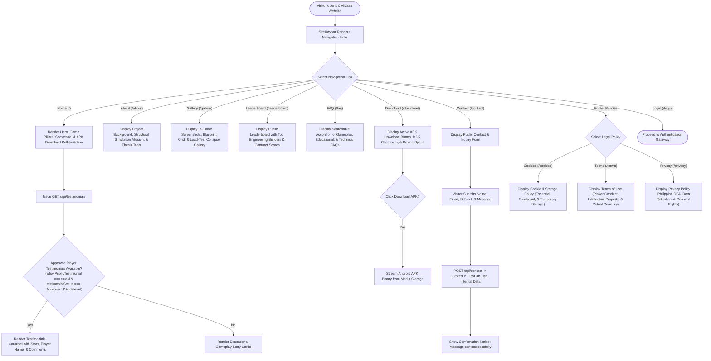
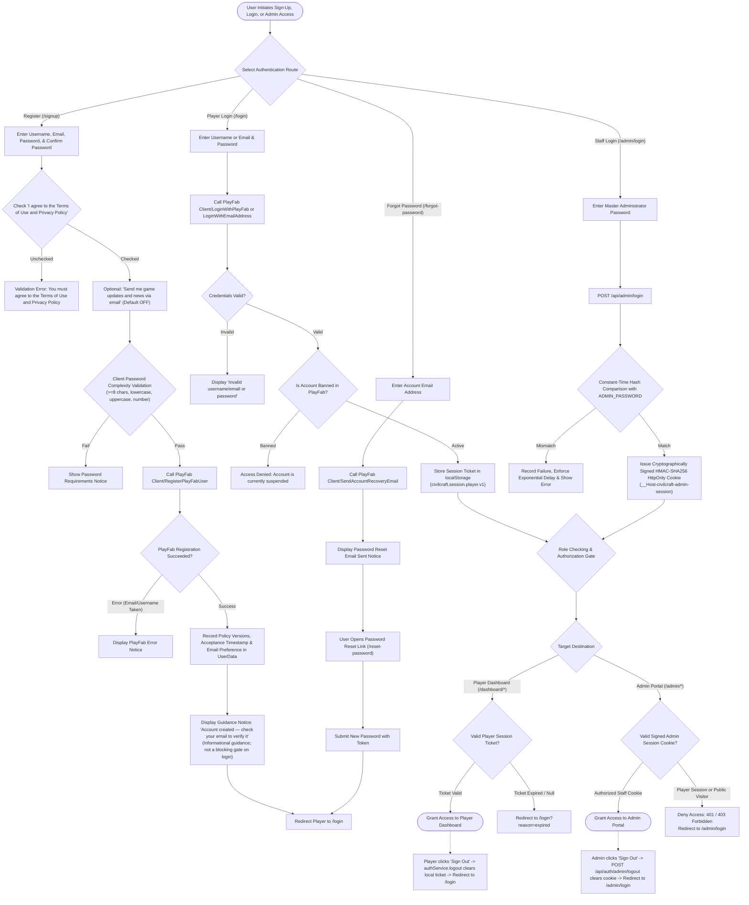
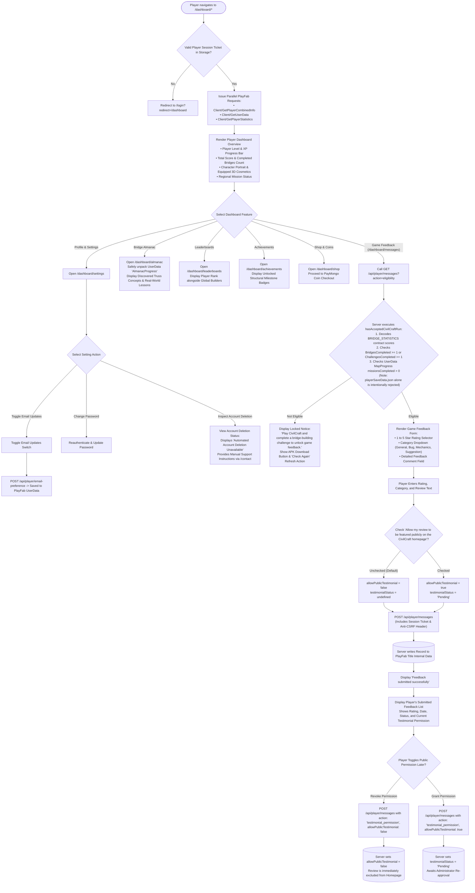
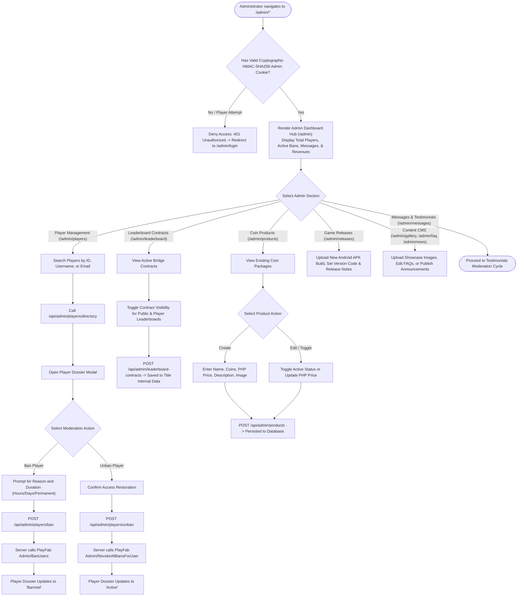
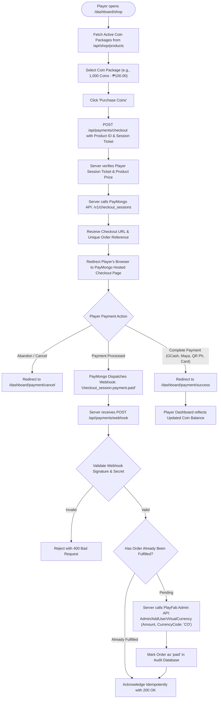
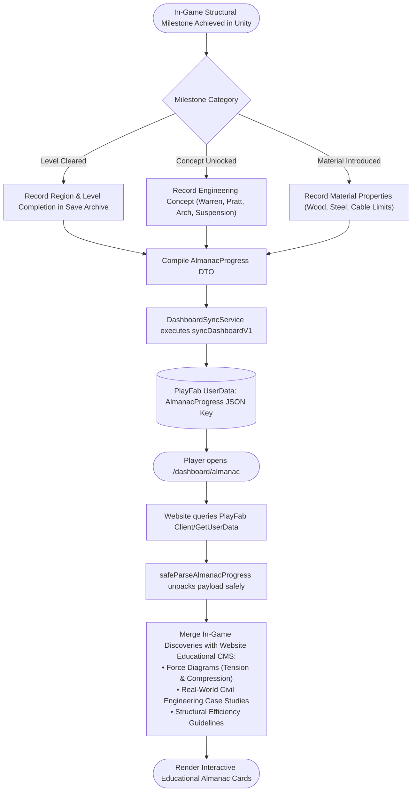
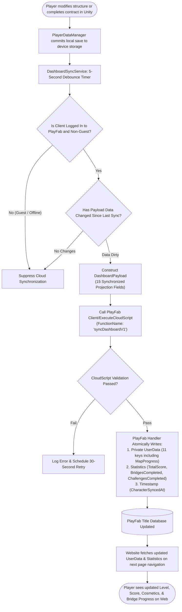

# CivilCraft: System Flowcharts & Architectural Diagrams

**Thesis System Architecture & Process Workflows**

---

## 1. Master Website Architecture & Navigation Flowchart

The following diagram illustrates the overarching system architecture and navigation flows of the CivilCraft web platform. It details the five core functional zones:

1. **Main Menu / Website Navigation**
2. **Public Website Subsystem** (unauthenticated browsing, legal policies, public leaderboard, and approved testimonials)
3. **Authentication & Authorization Gateway** (registration with mandatory policy consent, post-registration email notice, credential validation, signed admin cookies, and strict role separation)
4. **Player Website Subsystem** (protected dashboard, game records, bridge almanac, shop, and gameplay-verified feedback submission with consent management)
5. **Admin Website Subsystem** (protected back-office, player management, coin products, leaderboard contract visibility controls, and testimonial moderation)

External integration with **Cloud Services (PlayFab & PayMongo)** and the **Unity Client Synchronization** are documented in their authoritative boundaries.

```mermaid
flowchart TD
    %% -------------------------------------------------------------
    %% Visual Styling Classes
    %% -------------------------------------------------------------
    classDef navStyle fill:#fef3c7,stroke:#b45309,stroke-width:2px,color:#78350f;
    classDef publicStyle fill:#e0f2fe,stroke:#0284c7,stroke-width:2px,color:#0369a1;
    classDef authStyle fill:#fef9c3,stroke:#ca8a04,stroke-width:2px,color:#854d0e;
    classDef playerStyle fill:#dcfce7,stroke:#16a34a,stroke-width:2px,color:#15803d;
    classDef adminStyle fill:#f3e8ff,stroke:#9333ea,stroke-width:2px,color:#6b21a8;
    classDef cloudStyle fill:#f1f5f9,stroke:#64748b,stroke-width:2px,color:#334155;
    classDef decisionStyle fill:#fffbeb,stroke:#d97706,stroke-width:2px,color:#92400e;
    classDef lockedStyle fill:#fee2e2,stroke:#ef4444,stroke-width:2px,color:#b91c1c;

    %% Entry Point
    StartNav(["Visitor / User Enters CivilCraft Web Platform"]):::navStyle

    %% -------------------------------------------------------------
    %% 1. Main Menu / Website Navigation
    %% -------------------------------------------------------------
    subgraph MainNavSection ["1. Main Menu / Website Navigation"]
        MenuRoot["Top Navigation Bar (SiteNavbar)"]:::navStyle
        NavHome["Home (/)"]:::navStyle
        NavAbout["About (/about)"]:::navStyle
        NavGallery["Gallery (/gallery)"]:::navStyle
        NavLeaderboard["Leaderboard (/leaderboard)"]:::navStyle
        NavFAQ["FAQ (/faq)"]:::navStyle
        NavDownload["Download (/download)"]:::navStyle
        NavContact["Contact (/contact)"]:::navStyle
        NavLogin["Login (/login)"]:::navStyle
        NavFooter["Footer Navigation: Terms, Privacy, Cookies (/terms, /privacy, /cookies)"]:::navStyle
    end

    StartNav --> MenuRoot
    MenuRoot --> NavHome
    MenuRoot --> NavAbout
    MenuRoot --> NavGallery
    MenuRoot --> NavLeaderboard
    MenuRoot --> NavFAQ
    MenuRoot --> NavDownload
    MenuRoot --> NavContact
    MenuRoot --> NavLogin
    MenuRoot --> NavFooter

    %% -------------------------------------------------------------
    %% 2. Public Website Subsystem (No Authentication Required)
    %% -------------------------------------------------------------
    subgraph PublicSubsystem ["2. Public Website Subsystem (Unauthenticated Access)"]
        PubAuthCheck{"Authentication Required?"}:::decisionStyle

        PubHome["Homepage (/)<br/>• Hero & Mission Introduction<br/>• Game Features & Almanac Teaser<br/>• Android APK Download Call-to-Action<br/>• Public Testimonials Carousel (GET /api/testimonials)"]:::publicStyle
        PubAbout["About Page (/about)<br/>• Educational Mission & Thesis Context<br/>• Matrix Physics Simulation Architecture<br/>• Development Team & Technology Stack"]:::publicStyle
        PubGallery["Gallery Page (/gallery)<br/>• Bridge Construction Screenshots<br/>• Structural Failure & Stress Visualizations"]:::publicStyle
        PubFAQ["FAQ Page (/faq)<br/>• Educational & Game Mechanics FAQ<br/>• Mobile APK Installation & Troubleshooting"]:::publicStyle
        PubDownload["Download Page (/download)<br/>• Latest Android APK Build<br/>• Version Code & Minimum System Requirements"]:::publicStyle
        PubContact["Contact Page (/contact)<br/>• Public General / Feedback Inquiry Form<br/>• POST /api/contact"]:::publicStyle
        PubCookies["Cookie & Storage Policy (/cookies)<br/>• Essential, Functional, & Temporary Storage<br/>• Player-Facing Storage Clearing Guide"]:::publicStyle
        PubTerms["Terms of Use (/terms)<br/>• Player Responsibilities & Acceptable Use<br/>• Educational Boundaries & Virtual Currency Rules"]:::publicStyle
        PubPrivacy["Privacy Policy (/privacy)<br/>• Philippine Data Privacy Act Compliance<br/>• Data Collection, Retention, & User Rights"]:::publicStyle
        PubLeaderboard["Public Leaderboard (/leaderboard)<br/>• Read-Only Standings for Visitors & Players<br/>• Top Global Builders & Active Contract Scores"]:::publicStyle

        PubTestimonialsFilter{"Public Testimonials Filter Criteria<br/>1. allowPublicTestimonial === true (Explicit Consent)<br/>2. testimonialStatus === 'Approved' (Admin Approved)<br/>3. deleted !== true (Not Deleted)"}:::decisionStyle
    end

    NavHome --> PubAuthCheck
    NavAbout --> PubAuthCheck
    NavGallery --> PubAuthCheck
    NavFAQ --> PubAuthCheck
    NavDownload --> PubAuthCheck
    NavContact --> PubAuthCheck
    NavFooter --> PubAuthCheck
    NavLeaderboard --> PubAuthCheck

    PubAuthCheck -- "No (Public Access)" --> PubHome
    PubAuthCheck -- "No (Public Access)" --> PubAbout
    PubAuthCheck -- "No (Public Access)" --> PubGallery
    PubAuthCheck -- "No (Public Access)" --> PubFAQ
    PubAuthCheck -- "No (Public Access)" --> PubDownload
    PubAuthCheck -- "No (Public Access)" --> PubContact
    PubAuthCheck -- "No (Public Access)" --> PubCookies
    PubAuthCheck -- "No (Public Access)" --> PubTerms
    PubAuthCheck -- "No (Public Access)" --> PubPrivacy
    PubAuthCheck -- "No (Public Access)" --> PubLeaderboard

    PubHome -.->|Queries Approved Reviews| PubTestimonialsFilter

    %% -------------------------------------------------------------
    %% 3. Authentication & Authorization Gateway
    %% -------------------------------------------------------------
    subgraph AuthGateway ["3. Authentication & Authorization Gateway"]
        AuthEntry{"Select Authentication Path"}:::decisionStyle

        %% Player Registration Flow
        RegPage["Player Sign-Up (/signup)"]:::authStyle
        RegForm["Enter Username, Email, Password, Confirm Password"]:::authStyle
        RegTermsCheck{"Agreed to Terms & Privacy?<br/>(Mandatory Checkbox, Un-prechecked)"}:::decisionStyle
        RegEmailOpt["Optional Email Updates Checkbox<br/>(Consent Persisted in UserData, Default OFF)"]:::authStyle
        RegValidate{"Client Password Validation?<br/>(>=8 chars, upper, lower, number)"}:::decisionStyle
        RegSubmit["Call PlayFab Client/RegisterPlayFabUser"]:::authStyle
        RegRecordConsent["Store Policy Versions, Timestamp & Email Preference"]:::authStyle
        RegNotice["Post-Registration Notice: 'Verify your email'<br/>(Informational guidance notice; does NOT block login)"]:::authStyle

        %% Player Login Flow
        LoginPage["Player Login (/login)"]:::authStyle
        LoginForm["Enter Username or Email & Password"]:::authStyle
        LoginSubmit["Call PlayFab Client/LoginWithPlayFab or LoginWithEmailAddress"]:::authStyle
        LoginCredCheck{"Credentials Valid?"}:::decisionStyle
        LoginBanCheck{"Account Banned in PlayFab?"}:::decisionStyle
        LoginIssueTicket["Issue PlayFab Session Ticket<br/>(Stored in localStorage: civilcraft.session.player.v1)"]:::authStyle

        %% Password Recovery Flow
        ForgotPage["Forgot Password (/forgot-password)"]:::authStyle
        ForgotCall["Call PlayFab Client/SendAccountRecoveryEmail"]:::authStyle
        ResetPage["Reset Password with Recovery Token (/reset-password)"]:::authStyle

        %% Admin Login Flow
        AdminLoginPage["Staff Sign-In (/admin/login)"]:::authStyle
        AdminForm["Enter Staff Administrator Password"]:::authStyle
        AdminValidate{"Constant-Time Hash Matches ADMIN_PASSWORD?"}:::decisionStyle
        AdminIssueCookie["Issue Cryptographic HMAC-SHA256 Signed HttpOnly Cookie<br/>(__Host-civilcraft-admin-session)"]:::authStyle

        %% Role Checking & Authorization Gate
        RoleGate{"Role Checking & Authorization Gate"}:::decisionStyle
        IsPlayerSession{"Target is /dashboard/*?<br/>Check Valid Player Session Ticket"}:::decisionStyle
        IsAdminSession{"Target is /admin/*?<br/>Check Valid Signed Admin Cookie"}:::decisionStyle
        DenyAdminToPlayer["Block Regular Player from Admin Portal<br/>(401 / 403 Forbidden -> Redirect to /admin/login)"]:::lockedStyle
        RedirectPlayerExpired["Session Expired or Missing<br/>(Redirect to /login?reason=expired)"]:::authStyle
        RedirectAdminExpired["Admin Session Expired or Missing<br/>(Redirect to /admin/login)"]:::authStyle
    end

    NavLogin --> AuthEntry
    AuthEntry -- "Register Account" --> RegPage
    AuthEntry -- "Player Sign In" --> LoginPage
    AuthEntry -- "Staff Sign In" --> AdminLoginPage
    LoginPage -.->|Forgot Password Link| ForgotPage
    ForgotPage --> ForgotCall
    ForgotCall -.->|Recovery Link in Email| ResetPage
    ResetPage --> LoginPage

    %% Registration connections
    RegPage --> RegForm
    RegForm --> RegTermsCheck
    RegTermsCheck -- "Unchecked (Blocked)" --> RegPage
    RegTermsCheck -- "Checked" --> RegEmailOpt
    RegEmailOpt --> RegValidate
    RegValidate -- "Fail" --> RegPage
    RegValidate -- "Pass" --> RegSubmit
    RegSubmit --> RegRecordConsent
    RegRecordConsent --> RegNotice
    RegNotice --> LoginPage

    %% Login connections
    LoginPage --> LoginForm
    LoginForm --> LoginSubmit
    LoginSubmit --> LoginCredCheck
    LoginCredCheck -- "Invalid" --> LoginPage
    LoginCredCheck -- "Valid" --> LoginBanCheck
    LoginBanCheck -- "Banned" --> LoginPage
    LoginBanCheck -- "Active" --> LoginIssueTicket
    LoginIssueTicket --> RoleGate

    %% Admin Login connections
    AdminLoginPage --> AdminForm
    AdminForm --> AdminValidate
    AdminValidate -- "Mismatch / Throttled" --> AdminLoginPage
    AdminValidate -- "Match" --> AdminIssueCookie
    AdminIssueCookie --> RoleGate

    %% Authorization Gate Logic
    RoleGate --> IsPlayerSession
    RoleGate --> IsAdminSession

    IsPlayerSession -- "Valid Player Ticket" --> PlayerDashboardHome
    IsPlayerSession -- "Missing / Expired Ticket" --> RedirectPlayerExpired
    RedirectPlayerExpired --> LoginPage

    IsAdminSession -- "Valid Signed Staff Cookie" --> AdminDashboardHub
    IsAdminSession -- "Unauthorized Player / Missing Cookie" --> DenyAdminToPlayer
    IsAdminSession -- "Admin Cookie Expired" --> RedirectAdminExpired
    DenyAdminToPlayer --> AdminLoginPage
    RedirectAdminExpired --> AdminLoginPage

    %% -------------------------------------------------------------
    %% 4. Player Website Subsystem (Protected Player Access)
    %% -------------------------------------------------------------
    subgraph PlayerSubsystem ["4. Player Website Subsystem (Protected Player Access)"]
        PlayerDashboardHome["Player Dashboard Overview (/dashboard)<br/>• Level, XP Progress Bar, Total Score<br/>• Character Portrait & Equipped 3D Cosmetics<br/>• Regional Mission Progression & Quick Stats"]:::playerStyle

        PlayerProfile["Player Profile (/dashboard/profile)<br/>• Identity, Member Since, Last Login<br/>• PlayFab ID Display"]:::playerStyle

        PlayerSettings["Player Settings (/dashboard/settings)<br/>• Password Change & Reauthentication<br/>• Email Updates Toggle (POST /api/player/email-preference)<br/>• Delete Account: UNAVAILABLE BACKEND STATUS (Manual Contact Path)<br/>• Hidden Preview Controls (Public Profile, Compact Dashboard)"]:::playerStyle

        PlayerRecords["Game Records & Achievements (/dashboard/achievements)<br/>• Completed Engineering Milestone Badges<br/>• Regional Stars & Contract History"]:::playerStyle

        PlayerLeaderboard["Player Leaderboards (/dashboard/leaderboards)<br/>• Personal Standings & Global Rank"]:::playerStyle

        PlayerAlmanac["Bridge Almanac (/dashboard/almanac)<br/>• Structural Mechanics & Truss Concepts<br/>• In-Game Discovered Lessons & Materials"]:::playerStyle

        PlayerShop["Coin & Diamond Shop (/dashboard/shop, /dashboard/transactions)<br/>• Active Coin Packages Display<br/>• PayMongo Checkout Session Initiation<br/>• Player Purchase & Transaction History"]:::playerStyle

        %% Game Feedback Component
        subgraph FeedbackComponent ["Game Feedback & Testimonial System (/dashboard/messages)"]
            FeedbackGate{"Verified Gameplay Completion Check?<br/>(GET /api/player/messages?action=eligibility)"}:::decisionStyle
            CheckPFStats{"PlayFab Stats or UserData Verify Completed Bridge/Challenge?<br/>1. BridgesCompleted >= 1 OR ChallengesCompleted >= 1<br/>2. BRIDGE_STATISTICS contract score > 0<br/>3. MapProgress missionsCompleted > 0<br/>(Note: playerSaveData.json alone is REJECTED)"}:::decisionStyle
            FeedbackLocked["Display Challenge Locked Notice:<br/>'Play CivilCraft and complete a bridge-building challenge to unlock game feedback.'"]:::lockedStyle
            FeedbackForm["Display Game Feedback Form<br/>• 1 to 5 Star Rating Selector<br/>• Category Dropdown (General, Bug, Mechanics, Suggestion)<br/>• Detailed Feedback Comment Text"]:::playerStyle
            TestimonialConsentBox{"Allow Public Testimonial Checkbox<br/>(Optional, Default UNCHECKED)"}:::decisionStyle
            SubmitFeedback["POST /api/player/messages<br/>(Session Ticket & Anti-CSRF Origin Check)"]:::playerStyle
            StorePending["Store Message in PlayFab Title Internal Data<br/>(testimonialStatus = 'Pending' if consent granted)"]:::playerStyle
            PlayerConsentToggle["Player Consent Management<br/>(Player can view status and revoke permission at any time)"]:::playerStyle
        end

        PlayerSignOut["Player Sign Out<br/>(authService.logout clears local ticket -> Redirects to /login)"]:::authStyle
    end

    PlayerDashboardHome --> PlayerProfile
    PlayerDashboardHome --> PlayerSettings
    PlayerDashboardHome --> PlayerRecords
    PlayerDashboardHome --> PlayerLeaderboard
    PlayerDashboardHome --> PlayerAlmanac
    PlayerDashboardHome --> PlayerShop
    PlayerDashboardHome --> FeedbackGate
    PlayerDashboardHome --> PlayerSignOut
    PlayerSignOut --> LoginPage

    FeedbackGate --> CheckPFStats
    CheckPFStats -- "No Verified Gameplay" --> FeedbackLocked
    CheckPFStats -- "Verified Completion" --> FeedbackForm
    FeedbackForm --> TestimonialConsentBox
    TestimonialConsentBox --> SubmitFeedback
    SubmitFeedback --> StorePending
    StorePending --> PlayerConsentToggle

    %% -------------------------------------------------------------
    %% 5. Admin Website Subsystem (Protected Staff Access)
    %% -------------------------------------------------------------
    subgraph AdminSubsystem ["5. Admin Website Subsystem (Protected Staff Access)"]
        AdminDashboardHub["Admin Hub Overview (/admin)<br/>• System Health & Player Counts<br/>• Recent Inquiry & Moderation Counters"]:::adminStyle

        AdminPlayers["Player Management (/admin/players)<br/>• Directory Search by ID, Username, Email<br/>• Player Dossier Inspection<br/>• Ban Player (Admin/BanUsers)<br/>• Unban Player (Admin/RevokeAllBansForUser)"]:::adminStyle

        AdminProducts["Coin Products Management (/admin/products)<br/>• Add New Coin Package<br/>• Edit Price, Coins, Active Status"]:::adminStyle

        AdminTransactions["Transaction Audit (/admin/transactions)<br/>• Inspect PayMongo Orders & Currency Credit"]:::adminStyle

        AdminLeaderboardMod["Leaderboard Contracts Management (/admin/leaderboard)<br/>• Staff Administrative Controls<br/>• Inspect Active & Hidden Bridge Contracts<br/>• Toggle Contract Visibility via POST /api/admin/leaderboard-contracts"]:::adminStyle

        AdminReleases["Release Management (/admin/releases)<br/>• Upload Android APK Builds<br/>• Set Active Download Version & Release Notes"]:::adminStyle

        AdminCMS["Content Management CMS (/admin/gallery, /admin/faq, /admin/news)<br/>• Upload Gallery Screenshots<br/>• Manage FAQ Answers & News Bulletins"]:::adminStyle

        %% Messages & Testimonials Moderation
        subgraph AdminModeration ["Messages & Testimonials Moderation (/admin/messages, /admin/bugs)"]
            InboxList["Admin Inquiries & Feedback Inbox"]:::adminStyle
            FilterConsent["Filter for Messages with allowPublicTestimonial === true"]:::adminStyle
            ModDecision{"Admin Moderation Decision"}:::decisionStyle
            ActionApprove["Approve Testimonial for Homepage<br/>(POST /api/admin/messages: testimonialStatus = 'Approved')"]:::adminStyle
            ActionReject["Reject / Remove from Homepage<br/>(POST /api/admin/messages: testimonialStatus = 'Rejected')"]:::adminStyle
            StatusManagement["Update Inquiry Status (New, In Progress, Resolved) & Send Reply"]:::adminStyle
        end

        AdminSignOut["Admin Sign Out<br/>(POST /api/auth/admin/logout clears cookie -> Redirects to /admin/login)"]:::authStyle
    end

    AdminDashboardHub --> AdminPlayers
    AdminDashboardHub --> AdminProducts
    AdminDashboardHub --> AdminTransactions
    AdminDashboardHub --> AdminLeaderboardMod
    AdminDashboardHub --> AdminReleases
    AdminDashboardHub --> AdminCMS
    AdminDashboardHub --> InboxList
    AdminDashboardHub --> AdminSignOut
    AdminSignOut --> AdminLoginPage

    InboxList --> FilterConsent
    InboxList --> StatusManagement
    FilterConsent --> ModDecision
    ModDecision -- "Approve" --> ActionApprove
    ModDecision -- "Reject" --> ActionReject

    %% -------------------------------------------------------------
    %% 6. Cloud Services & External Integrations
    %% -------------------------------------------------------------
    subgraph CloudServices ["6. Cloud Backend & External Services"]
        PFAuthService["PlayFab Authentication Service<br/>• Client/RegisterPlayFabUser<br/>• Client/LoginWithPlayFab"]:::cloudStyle
        PFSessionValidator["PlayFab Server Session Validator<br/>• Server/AuthenticateSessionTicket"]:::cloudStyle
        PFTitleData[("PlayFab Title Internal Data<br/>• Player Messages & Inquiries<br/>• Testimonial Consent & Status<br/>• Leaderboard Contract Controls")]:::cloudStyle
        PFUserData[("PlayFab UserData & Statistics<br/>• BridgesCompleted, ChallengesCompleted<br/>• MapProgress & BRIDGE_STATISTICS<br/>• EmailUpdatesSubscribed")]:::cloudStyle
        PayMongoGW["PayMongo Payment Gateway<br/>• Hosted Checkout (GCash, Maya, Cards)<br/>• Webhook Verification & Currency Credit"]:::cloudStyle
    end

    %% Closed-Loop Feedback -> Moderation -> Public Testimonials
    StorePending -.->|Writes Record with Status 'Pending'| PFTitleData
    PFTitleData -.->|Populates Admin Moderation Inbox| InboxList
    ActionApprove -.->|Updates Status to 'Approved'| PFTitleData
    ActionReject -.->|Updates Status to 'Rejected'| PFTitleData
    PlayerConsentToggle -.->|Player Revoking Consent Hides Instantly| PFTitleData
    PFTitleData -.->|Queried by GET /api/testimonials| PubTestimonialsFilter
    PubTestimonialsFilter -.->|Supplies Approved Testimonials| PubHome

    %% External Connections
    RegSubmit -.-> PFAuthService
    LoginSubmit -.-> PFAuthService
    IsPlayerSession -.-> PFSessionValidator
    CheckPFStats -.-> PFUserData
    AdminPlayers -.-> PFAuthService
    PlayerShop -.-> PayMongoGW
    PayMongoGW -.->|Webhook Fulfills Virtual Currency| PFUserData
```

---

## 2. Detailed Process Flowcharts

### 2.1 Main Navigation & Public Web Browsing Flow

This workflow illustrates how unauthenticated visitors navigate the CivilCraft web platform, interact with public content and legal documents, inspect community leaderboards, view verified player testimonials, and branch to authentication.



---

### 2.2 Registration, Authentication & Role Authorization Flow

This flowchart details player registration with mandatory policy consent, credential verification, PlayFab session ticket creation, staff administrator authentication with signed cookies, and the strict role authorization gate that blocks ordinary players from administrative functions.



---

### 2.3 Player Website & Verified Gameplay Feedback Submission Flow

This workflow illustrates how authenticated players access dashboard features, manage their account preferences, and submit game feedback only after completing verified gameplay milestones.



---

### 2.4 Administrative Operations & Moderation Flow

This workflow illustrates how verified administrators manage players, moderate testimonials, configure coin packages, and control leaderboard visibility.



---

### 2.5 End-to-End Testimonial Moderation & Public Display Lifecycle Flow

This sequence flowchart details the complete, closed-loop lifecycle: verified player submission, administrative review, approved publication on the homepage, and instant removal upon player consent revocation.

```mermaid
flowchart TD
    %% 1. Submission
    Step1(["1. Eligible Player Submits Feedback in /dashboard/messages"]) --> FormInput["Player provides Star Rating (1-5), Category, Review Text<br/>Checks: 'Allow my review to be featured publicly on the CivilCraft homepage'"]
    FormInput --> PostMsg["POST /api/player/messages"]
    PostMsg --> SaveRecord["Server validates session identity & saves to PlayFab Title Internal Data:<br/>• allowPublicTestimonial = true<br/>• testimonialStatus = 'Pending'<br/>• status = 'New'"]

    %% 2. Admin Moderation
    SaveRecord --> AdminOpensInbox["2. Administrator opens /admin/messages"]
    AdminOpensInbox --> FilterTestimonials["Filter by Testimonials Tab (allowPublicTestimonial === true)"]
    FilterTestimonials --> AdminInspects["Admin inspects Player Name, Star Rating, and Comment"]
    AdminInspects --> AdminDecision{"Moderation Decision"}

    AdminDecision -- "Reject" --> ClickReject["Click 'Reject / Remove from Homepage'"]
    ClickReject --> PostRejectAPI["POST /api/admin/messages with action: 'testimonial_status', status: 'Rejected'"]
    PostRejectAPI --> TitleDataReject[("Title Internal Data: testimonialStatus updated to 'Rejected'")]
    TitleDataReject --> FeedbackRejectedNotice["Review is flagged as Rejected and will NEVER appear publicly"]

    AdminDecision -- "Approve" --> ClickApprove["Click 'Approve for Homepage'"]
    ClickApprove --> PostApproveAPI["POST /api/admin/messages with action: 'testimonial_status', status: 'Approved'"]
    PostApproveAPI --> TitleDataApprove[("Title Internal Data: testimonialStatus updated to 'Approved'")]

    %% 3. Public Display
    TitleDataApprove --> VisitorVisitsHome["3. Public Visitor Loads Homepage (/)"]
    VisitorVisitsHome --> HomeFetch["Homepage component triggers useTestimonials() -> GET /api/testimonials"]
    HomeFetch --> BackendFilter{"Backend /api/testimonials Query & Filter:<br/>1. allowPublicTestimonial === true (Consent Granted)<br/>2. testimonialStatus === 'Approved' (Staff Approved)<br/>3. deleted !== true (Not Deleted)"}
    BackendFilter -- "Matches All 3 Rules" --> ReturnJSON["Return Clean JSON Array: [{ id, name, message, rating, inquiryType, createdAt }]"]
    ReturnJSON --> RenderHomeCarousel["Homepage renders Testimonial Card with Star Rating, Player Name, and Review Text"]

    %% 4. Revocation
    RenderHomeCarousel -.-> PlayerRevokesConsent["4. Player later navigates to /dashboard/messages and UNCHECKS public consent"]
    PlayerRevokesConsent --> PostRevoke["POST /api/player/messages with action: 'testimonial_permission', allowPublicTestimonial: false"]
    PostRevoke --> TitleDataRevoke[("Title Internal Data: allowPublicTestimonial updated to false")]
    TitleDataRevoke --> NextPublicFetch["Subsequent GET /api/testimonials Call"]
    NextPublicFetch --> FilterExcludes["Backend Filter Excludes Review (allowPublicTestimonial is false)"]
    FilterExcludes --> ImmediateRemoval(["Testimonial is Immediately Removed from Homepage Carousel"])
```



---

### 2.6 Coin Purchase & Payment Fulfillment Flow (PayMongo)

This diagram details the transaction workflow between the Player Shop, the PayMongo checkout gateway, webhook signature verification, and automated PlayFab virtual currency (`CO`) fulfillment.



---

### 2.7 Educational Bridge Almanac & Discovery Flow

This flowchart illustrates the synchronization of structural engineering lessons from in-game milestones into the website's educational Bridge Almanac.



---

### 2.8 Unity Game Client to Cloud Data Synchronization Flow

This flowchart illustrates the background synchronization mechanism linking the Unity Android simulation client with PlayFab, which directly fuels the web platform's statistics and dashboard displays.


